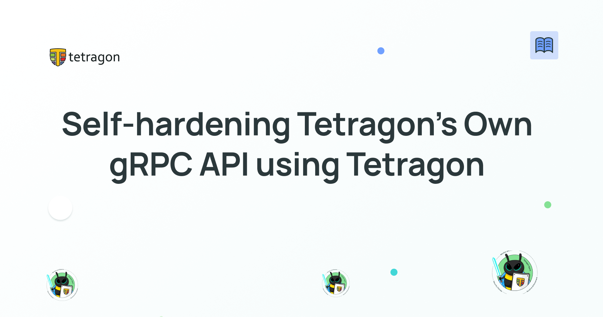

import authors from 'utils/author-data';



Tetragon versions before v1.7 expose an unauthenticated gRPC admin API on `localhost:54321`, and any pod running with `hostNetwork: true` on the same node can reach it. This is tracked as [CVE-2026-65960](https://github.com/cilium/tetragon/security/advisories/GHSA-6qqg-3qf7-p3v5) and rated high severity. Tetragon v1.7 fixes it by exposing the API over a Unix domain socket (UDS) by default. If you can't upgrade yet, or you need to keep the API on TCP, you can apply a Tetragon tracing policy that blocks workloads from connecting to it.

Tetragon runs as a privileged process, so the interfaces it exposes are part of its own security posture and need the same scrutiny as the workloads it protects.

This post covers what the gRPC API exposes, how a host-networked workload can reach it, how Tetragon's threat model frames the risk, and how to block that access live with Tetragon's own enforcement.

## Background

This issue was reported to the Cilium security team by GitHub user [haoxucu](https://github.com/haoxucu), whom we thank for reporting it responsibly. It was published on July 27, 2026 in GitHub security advisory [GHSA-6qqg-3qf7-p3v5](https://github.com/cilium/tetragon/security/advisories/GHSA-6qqg-3qf7-p3v5) as CVE-2026-65960. The advisory covers all Tetragon versions before v1.7.0. Alongside the patch, the advisory lists workarounds for users who cannot upgrade, including the tracing policy covered later in this post.

The gRPC API is administrative: it can modify tracing policies, change debug settings, and otherwise alter the agent's behavior. Given Tetragon's privileged position on the node, access to this API is a security boundary in its own right.

Tetragon can expose the API over a Unix domain socket (UDS), where filesystem permissions control access, or over TCP. Before v1.7, the default was a TCP listener on `localhost:54321`. Since v1.7, the default is a UDS, and TCP is used only when operators configure it explicitly.


A TCP listener bound to `127.0.0.1` looks reachable only from the node itself. However, Kubernetes pods with `hostNetwork: true` share the node's network namespace, including its loopback interface. As the diagram shows, a compromised or malicious host-networked pod can therefore connect to the unauthenticated API on `127.0.0.1:54321`, while pods in their own network namespaces cannot.

Tetragon's [threat model](https://tetragon.io/docs/threat-model/) describes this class of risk in general terms. It warns that an attacker with access to the node's localhost interface can connect to a network-exposed gRPC port and read or modify tracing policies, just as someone with access to the UDS could. It recommends that operators move to UDS-based access where possible. This is why the security tool itself belongs in the threat model: it brings risks in the tool's own interfaces to the surface so operators can act on them.

### Check whether you are affected

You are affected if you run a Tetragon version earlier than v1.7 with the default settings, or any version with the gRPC API configured on a TCP address. To check, read the `server-address` value from the Tetragon ConfigMap. With a Helm release named `tetragon`, the ConfigMap is `tetragon-config`:

```
kubectl get configmap -n kube-system tetragon-config -o jsonpath='{.data.server-address}'
```

A TCP address such as `localhost:54321` means the API is exposed over TCP. A `unix://` address means it is exposed over a UDS, and an empty value means the gRPC API is disabled.

## Protecting Tetragon with Tetragon

The recommended fix is to remove the network exposure: upgrade to v1.7 or later, switch the API to a UDS, or disable it if you don't need it. When none of these is practical yet, Tetragon can provide its own mitigation.

The Tetragon community and the Isovalent team wrote a [tracing policy](https://github.com/cilium/tetragon/blob/5156788ccea1857c413355836054a5099be74b8f/examples/tracingpolicy/cves/cve-2026-65960.yaml) that prevents workloads from connecting to the gRPC API. It requires no change to how you use the API and no additional security tool: Tetragon's existing runtime enforcement puts a boundary around the agent itself.

### How the policy works

The policy's goal is to keep Kubernetes workloads away from the gRPC API while leaving it reachable for legitimate host-level processes. Conceptually, it enforces this rule:

> Deny any connection to `127.0.0.1:54321` unless it comes from a root process in the host's cgroup namespace.

Tetragon enforces this when a process tries to open the connection, so a denied request never reaches the API. Here is the policy:

```yaml
apiVersion: cilium.io/v1alpha1
kind: TracingPolicy
metadata:
  name: cve-2026-65960
  annotations:
    created-at: '2026-07-02T10:12:45Z'
    description: Unauthenticated Tetragon gRPC admin API accessible from hostNetwork pods
spec:
  kprobes:
    - call: security_socket_connect
      syscall: false
      args:
        - index: 1
          type: sockaddr
      data:
        - index: 0
          source: current_task
          type: uint32
          resolve: cred.euid.val
          label: euid
      selectors:
        - matchArgs:
            - index: 1
              operator: SAddr
              values:
                - 127.0.0.1
            - index: 1
              operator: SPort
              values:
                - '54321'
          matchNamespaces:
            - namespace: Cgroup
              operator: NotIn
              values:
                - host_ns
          matchActions:
            - action: Post
            - action: NotifyEnforcer
              argError: -1
        - matchArgs:
            - index: 1
              operator: SAddr
              values:
                - 127.0.0.1
            - index: 1
              operator: SPort
              values:
                - '54321'
          matchData:
            - index: 0
              operator: NotEqual
              values:
                - '0'
          matchNamespaces:
            - namespace: Cgroup
              operator: In
              values:
                - host_ns
          matchActions:
            - action: Post
            - action: NotifyEnforcer
              argError: -1
      message: cve-embargo vulnerability protection
  enforcers:
    - calls:
        - security_socket_connect
```

The policy uses a `kprobe` on the kernel's `security_socket_connect` function, an LSM hook that runs whenever a process initiates a socket connection and that exposes the destination address and port.

The policy has two selectors. Both match connections to `127.0.0.1` on port `54321`, the Tetragon gRPC API, and then check who is connecting:

- The first selector matches connections from any process outside the host's cgroup namespace, such as a Kubernetes workload. These connections are reported and denied.
- The second selector matches connections from processes in the host's cgroup namespace whose effective user ID is not `0`. The `data` block reads this value (`cred.euid.val`) from the current task. These connections are also reported and denied.

As a result, only root processes running on the host can connect to the Tetragon gRPC API.

**Note:** If you have configured Tetragon to expose its gRPC API on a different address or port, adjust the `SAddr` and `SPort` values in the policy. Tetragon v1.7 and later use a UDS by default, but if you configure the API on a TCP address, you are exposed in the same way and can apply this policy too.

### Reproduce the issue in a Kind cluster

To demonstrate the mitigation, we set up a Kind cluster and deploy Tetragon v1.6, which still uses TCP by default. The commands in this section use bash syntax.

First, we create the Kind cluster and mount the host's `/proc` filesystem into the Kind node, so Tetragon can read host process information from inside the node.

```
cat <<EOF > kind-config.yaml
apiVersion: kind.x-k8s.io/v1alpha4
kind: Cluster
nodes:
  - role: control-plane
    extraMounts:
      - hostPath: /proc
        containerPath: /procHost
EOF
kind create cluster --config kind-config.yaml
EXTRA_HELM_FLAGS=(--set tetragon.hostProcPath=/procHost) # flags for helm install
```

Then we install Tetragon v1.6 from the Cilium Helm repository:

```
helm repo add cilium https://helm.cilium.io
helm repo update
helm install tetragon "${EXTRA_HELM_FLAGS[@]}" cilium/tetragon -n kube-system --version=1.6.0
kubectl rollout status -n kube-system ds/tetragon -w
```

Next, we deploy a pod running grpcurl, a command-line client for gRPC services. The pod sets `hostNetwork: true`, so it shares the Kind node's network namespace.

```
cat <<EOF | kubectl apply -f -
apiVersion: v1
kind: Pod
metadata:
  name: grpc-client
spec:
  hostNetwork: true
  containers:
    - name: grpcurl
      image: fullstorydev/grpcurl:v1.9.3-alpine
      command: ["sleep", "infinity"]
EOF
```

We open a shell inside the pod:

```
kubectl exec -it grpc-client -- /bin/sh
```

From inside the `grpc-client` pod, we connect to Tetragon's gRPC API:

```
grpcurl -plaintext 127.0.0.1:54321 list

Failed to list services: server does not support the reflection API
```

Tetragon does not expose the gRPC reflection API, so grpcurl cannot list the available services. The error still shows that the request reached the Tetragon gRPC server, which replied that reflection is not supported. We have reproduced the issue described in the advisory: a pod sharing the host network namespace can reach Tetragon's unauthenticated gRPC API.

To watch Tetragon's events, open a second terminal on your workstation and start streaming them for the `grpc-client` pod before running `grpcurl` again (press Ctrl+C to stop). No tracing policy is loaded yet, so Tetragon reports only the process executions, and nothing stops the connections:

```
kubectl exec -ti -n kube-system ds/tetragon -c tetragon -- tetra getevents -o compact --pods grpc-client

🚀 process default/grpc-client /bin/sh
🚀 process default/grpc-client /bin/grpcurl -plaintext 127.0.0.1:54321 list
🚀 process default/grpc-client /bin/grpcurl -plaintext 127.0.0.1:54321 list
```

### Apply the policy and verify the denial

Next, we apply the tracing policy:

```
kubectl apply -f https://raw.githubusercontent.com/cilium/tetragon/5156788ccea1857c413355836054a5099be74b8f/examples/tracingpolicy/cves/cve-2026-65960.yaml
```

With the policy loaded, we retry the connection from the `grpc-client` pod. Tetragon intercepts it at `security_socket_connect` and denies it because it comes from a Kubernetes workload, so the request never reaches the gRPC server:

```
grpcurl -plaintext 127.0.0.1:54321 list

Failed to dial target host "127.0.0.1:54321": connection error: desc = "transport: error while dialing: dial tcp 127.0.0.1:54321: connect: operation not permitted"
```

The policy also blocks `tetra` commands run through `kubectl exec ds/tetragon`, such as the `tetra getevents` command used earlier: the Tetragon pod is itself a Kubernetes workload, so its connections to the API are denied too. On a regular node, root processes running directly on the host, outside any container, can still use `tetra`.

To confirm that Tetragon recorded the denial, we pipe the agent's exported events into `tetra` on stdin, which does not need the API:

```
kubectl logs -n kube-system ds/tetragon -c export-stdout \
  | kubectl exec -i -n kube-system ds/tetragon -c tetragon -- tetra getevents -o compact --pods grpc-client \
  | tail -3

🚀 process default/grpc-client /bin/grpcurl -plaintext 127.0.0.1:54321 list
❓ syscall default/grpc-client /bin/grpcurl security_socket_connect
💥 exit    default/grpc-client /bin/grpcurl -plaintext 127.0.0.1:54321 list 1
```

The `❓ syscall` line is the event from the policy's `Post` action: `/bin/grpcurl` in pod `default/grpc-client` called `security_socket_connect`, Tetragon denied it, and the process exited with status `1`. The JSON event has the full details:

```
kubectl logs -n kube-system ds/tetragon -c export-stdout \
  | jq 'select(.process_kprobe) | .process_kprobe | {process: {binary: .process.binary, uid: .process.uid, pod: .process.pod.name}, function_name, policy_name, action, args, data}'
```

```json
{
  "process": {
    "binary": "/bin/grpcurl",
    "uid": 100,
    "pod": "grpc-client"
  },
  "function_name": "security_socket_connect",
  "policy_name": "cve-2026-65960",
  "action": "KPROBE_ACTION_NOTIFYENFORCER",
  "args": [
    {
      "sockaddr_arg": {
        "family": "AF_INET",
        "addr": "127.0.0.1",
        "port": 54321
      }
    }
  ],
  "data": [
    {
      "uint_arg": 100,
      "label": "euid"
    }
  ]
}
```

The event shows which process tried to connect, from which pod, to which address, and which policy denied it.

## Conclusion

Upgrade to Tetragon v1.7 or later, which exposes the gRPC API over a UDS by default and fixes CVE-2026-65960. If you can't upgrade yet, or you need to keep the gRPC API on TCP, apply the tracing policy from this post, adjusting `SAddr` and `SPort` if you changed the default address. Tetragon's own enforcement then keeps Kubernetes workloads away from its admin API.

Tetragon observes process execution, file access, and network activity with full Kubernetes context, and it can enforce policy in the kernel. Teams such as [Reddit](https://cilium.io/blog/2025/04/15/tetragon-social-networking-user-story/), [SUSE](https://www.youtube.com/watch?v=bgCg1tS72ME&list=PLDg_GiBbAx-mSQHa1y9Z9sjBYUmG2FBCZ&index=8), and [Viasat](https://youtube.com/shorts/HqJCDAXDkUE?si=2F-foPWY9GB7OKSa) use it for runtime security in production. See more on the [Cilium adopters page](https://cilium.io/adopters/).

To get started with Tetragon, visit the [Tetragon website](https://tetragon.io/), try out the guides in its [official documentation](https://tetragon.io/docs/getting-started/), and join the `#tetragon` channel on [Cilium Slack](https://slack.cilium.io/) to ask questions and connect with the community.

## Additional Resources

- [Tetragon Threat Model](https://tetragon.io/docs/threat-model/)
- [CVE-2026-65960 tracing policy](https://github.com/cilium/tetragon/blob/5156788ccea1857c413355836054a5099be74b8f/examples/tracingpolicy/cves/cve-2026-65960.yaml)
- [GitHub Security Advisory: GHSA-6qqg-3qf7-p3v5](https://github.com/cilium/tetragon/security/advisories/GHSA-6qqg-3qf7-p3v5)

<BlogAuthor {...authors.PaulArah} />
